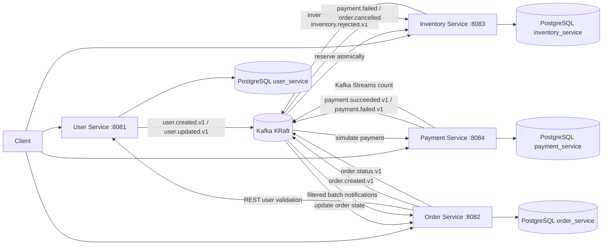
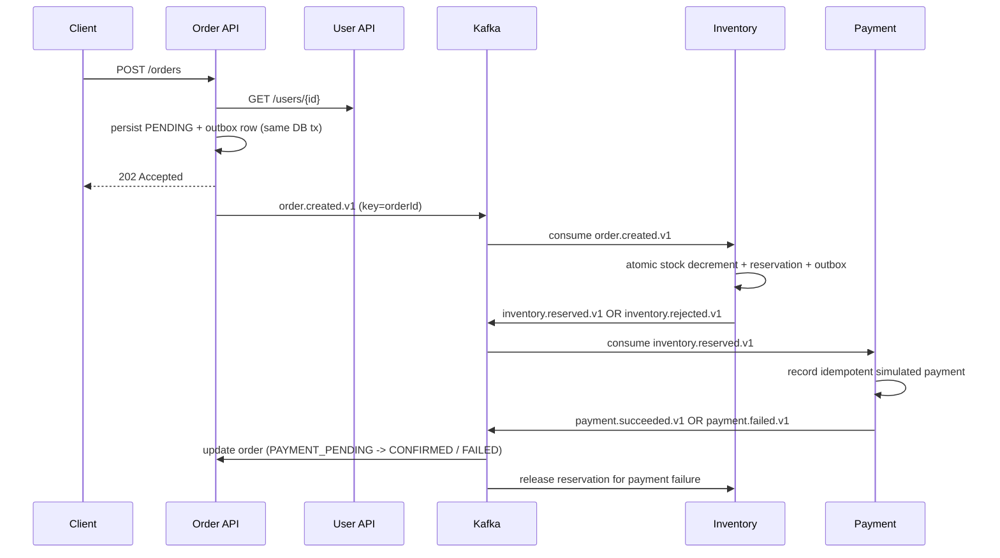

# Kafka E-Commerce Microservices

Runnable Java 17 / Spring Boot 3.3.5 / Spring Kafka 3.2.x example of an event-driven order saga. The Maven reactor contains four independently runnable services and a shared event-contract module. Each service owns a PostgreSQL schema, migrations, tables, inbox, and transactional outbox.

## Architecture



### Event flow and state transitions



Expected successful status progression: `PENDING -> INVENTORY_RESERVED -> PAYMENT_PENDING -> CONFIRMED`. The processing flow can jump to `FAILED` for unavailable stock or a simulated payment decline. Cancel uses `CANCELLED`; duplicate or late events do not move a terminal order back to a non-terminal state.

## Run locally

Prerequisites: Docker Desktop with Compose, Java 17, and Maven 3.9+ (for running Maven outside Docker).

```powershell
# Build all modules
mvn -B clean verify

# Start Kafka (KRaft), PostgreSQL, and all services
docker compose up --build -d
docker compose ps
docker compose logs -f order-service

# Stop containers but retain database data
docker compose down
# Also remove the local PostgreSQL volume (destructive to local data)
docker compose down -v
```

Compose uses PostgreSQL 16.4, Apache Kafka 3.8.0 in single-node KRaft mode, Maven 3.9.9 with Temurin 17 to build, and Temurin 17.0.13_11 for runtime. The local single-broker setup uses replication factor 1; production requires multiple brokers and appropriate replication/min-ISR settings. Services wait for Kafka/PostgreSQL health checks. Flyway creates the service schema and applies its migrations at startup. Kafka topic beans provision three-partition topics and matching DLTs.

### API walkthrough

Swagger UI: `http://localhost:8081/swagger-ui.html` through `http://localhost:8084/swagger-ui.html`. OpenAPI JSON is at each service's `/v3/api-docs`. A Postman collection is at [`postman/Kafka-Ecommerce.postman_collection.json`](./postman/Kafka-Ecommerce.postman_collection.json).

```powershell
# Create user; save returned id as USER_ID
curl.exe -i -X POST http://localhost:8081/users -H "Content-Type: application/json" `
  -d "{\"email\":\"alex@example.com\",\"fullName\":\"Alex Example\"}"

# Seed one product
curl.exe -i -X PUT http://localhost:8083/inventory/demo-sku/stock `
  -H "Content-Type: application/json" -d "{\"availableStock\":10}"

# Create an order (use actual USER_ID from response)
curl.exe -i -X POST http://localhost:8082/orders -H "Content-Type: application/json" `
  -d "{\"userId\":\"USER_ID\",\"productId\":\"demo-sku\",\"quantity\":1,\"amount\":19.99,\"currency\":\"USD\",\"simulatePaymentFailure\":false}"

# Poll GET /orders/{orderId} until CONFIRMED or FAILED.
# To demonstrate the compensation flow, create with simulatePaymentFailure=true.
# Query stock before and after; a payment decline restores the reserved unit.
```

All IDs are UUIDs. Order creation returns `202 Accepted` because the saga is asynchronous. User creation returns `201`; missing users are rejected with `422`, missing resources with `404`, invalid bodies with `400`, and invalid refund/cancel transitions with `409`. Send `X-Correlation-Id` to propagate a trace identifier; services generate one when it is omitted.

## Project modules

- `event-contracts`: versioned immutable event records, topic names, inbox/outbox helpers, retry/DLT and topic configuration.
- `user-service`: `POST /users`, `GET /users/{id}`, `PUT /users/{id}`; publishes user-created and user-updated events.
- `order-service`: order REST API and saga state machine; REST-validates the user; consumes inventory/payment outcomes.
- `inventory-service`: stock API; atomic conditional SQL decrement prevents overselling; order/payment compensation releases a reservation exactly once.
- `payment-service`: simulated payment and refund API; stable payment ID/idempotency key per order; Kafka Streams success counter.

Each service uses the same local PostgreSQL database server but a separate schema (`user_service`, `order_service`, `inventory_service`, `payment_service`), credentials/configuration, Flyway migration set, and data tables. This is a local convenience; schema isolation is not a substitute for separate production databases/credentials.

## Kafka implementation guide

| Feature | Demonstration |
|---|---|
| Producers/consumers, JSON, unique event/correlation IDs | `OutboxWriter`, `Events`, and each `*Listeners`; event records are serialized as JSON |
| Topics, partitions, replication | `KafkaSupportConfiguration`: named `*.v1` topics, 3 partitions, local replication factor 1 |
| Keys and ordering | Every event is keyed by `orderId` (user events by `userId`); same-key records in a topic share partition/order |
| Consumer groups/instances | Dedicated group per service; listener concurrency 3 where configured and bounded by partitions |
| Offset management/ack | Kafka auto-commit is off; record listener ack mode is used; listener returns only after DB transaction commits |
| Retries, exponential backoff, DLT | Shared `DefaultErrorHandler`: 3 retries, 500 ms initial exponential backoff capped at 5 s; recovery publishes to `<topic>.dlt` |
| Idempotent producers/consumers | Producer `enable.idempotence=true`, `acks=all`; unique `(consumer_name,event_id)` inbox; database unique constraints for order/payment/reservation |
| Outbox | Domain state and outbox row are committed together; scheduled publisher sends and marks published. A crash after Kafka send can replay a message, which inbox deduplication handles |
| Batch consumption, filtering, routing | Order notification listener consumes `order.status.v1` in batches and logs only final `CONFIRMED`, `FAILED`, `CANCELLED` statuses; separate event topics route work to interested groups |
| Kafka Streams | Payment service counts successful payment events into `payment.success-counts.v1` using a persistent local state store |
| Kafka transactions | `POST /kafka-demo/transaction` uses a separate transactional producer to publish two records atomically to `demo.transactional.v1`; consumers use `read_committed` isolation |
| Schema evolution | Topic names carry major contract version (`.v1`). Add optional fields with backward-compatible defaults; do not repurpose fields or change their meaning. Introduce a new versioned topic for incompatible changes |
| Event replay and lag | Reset a stopped group with the CLI examples below; inspect lag with `kafka-consumer-groups.sh` |
| SASL/SSL configuration | All services accept `KAFKA_SECURITY_PROTOCOL`, `KAFKA_SASL_MECHANISM`, `KAFKA_SASL_JAAS_CONFIG`, and `KAFKA_SSL_TRUSTSTORE_LOCATION`; supply real broker trust material and secrets outside source control |

Request/reply is intentionally not used in the order workflow: user existence is a bounded synchronous REST validation, while Kafka events drive long-running saga steps. Blocking the order API on a Kafka reply would couple its availability/latency to multiple consumers and would not make the saga atomic.

The transaction endpoint is an isolated Kafka-only demonstration, not a replacement for the outbox. For example, `curl.exe -X POST http://localhost:8084/kafka-demo/transaction -H "Content-Type: application/json" -d "{\"key\":\"demo-1\",\"firstMessage\":\"part-1\",\"secondMessage\":\"part-2\"}"` commits both demo records together. A failure before the transaction commits makes neither visible to `read_committed` consumers; it still cannot roll back PostgreSQL or a real payment provider.

### Replay and consumer lag

Commands run inside the broker container; stop the relevant service before resetting its group. Resetting offsets can repeat side effects, so inbox constraints must remain enabled.

```powershell
docker compose exec kafka /opt/kafka/bin/kafka-consumer-groups.sh --bootstrap-server kafka:9092 --describe --group inventory-service
docker compose exec kafka /opt/kafka/bin/kafka-consumer-groups.sh --bootstrap-server kafka:9092 --group inventory-service --topic order.created.v1 --reset-offsets --to-earliest --execute
docker compose exec kafka /opt/kafka/bin/kafka-console-consumer.sh --bootstrap-server kafka:9092 --topic order.created.v1 --from-beginning --property print.key=true
docker compose exec kafka /opt/kafka/bin/kafka-topics.sh --bootstrap-server kafka:9092 --describe --topic order.created.v1
```

The Streams app uses its own application ID/state store. Resetting that app's offsets also requires stopping payment-service and deleting/cleaning its local state store or applying the corresponding Kafka Streams reset procedure.

### Transactions and payment safety

The PostgreSQL outbox closes the database/Kafka dual-write gap for service-owned business state. Kafka producer idempotence reduces duplicate writes from producer retries, but it does not make a PostgreSQL transaction atomic with a Kafka transaction. Even Kafka transactions only atomically coordinate Kafka records/offsets. They cannot atomically include PostgreSQL or an external payment provider.

This example deliberately has no real gateway: a request-controlled flag simulates an immediate decline, otherwise payment succeeds and is recorded in PostgreSQL. A real gateway integration must use a stable provider idempotency key, persist an intent before calling the provider, treat timeouts as **unknown** (not failed), query/reconcile provider status, and use compensating refunds. Never call an external provider and assume Kafka transactions roll back its effect.

## Tests

```powershell
# Unit tests plus Docker-backed integration test (the latter is skipped if Docker is unavailable)
mvn -B test
```

`OrderStateTest` exercises terminal/out-of-order transitions, `UserRequestTest` validates DTO constraints, and `InventoryConcurrencyTest` uses Testcontainers PostgreSQL to race two orders for one unit of stock. Docker must be available for the Testcontainers case. For a full deployment-level smoke test, start Compose and follow the API walkthrough; listener restart/replay is covered by offset-reset guidance and database inbox/outbox persistence.

## Operations and troubleshooting

- **Kafka connection refused:** from host, Kafka is `localhost:29092`; from Compose containers, use `kafka:9092`. Do not configure containers to use `localhost:9092`.
- **Service waits/unhealthy:** inspect `docker compose ps` and `docker compose logs kafka postgres <service>`. Health checks gate startup; Flyway logs migration errors during service boot.
- **Topic/metadata errors:** confirm broker health and topic creation; local topic replication is 1. DLTs are created alongside event topics.
- **Message repeatedly fails:** after configured retries, inspect `<topic>.dlt` with `kafka-console-consumer.sh`. Fix the payload/handler, then replay deliberately; inbox IDs will suppress already committed work.
- **Order stays pending:** check consumer group lag and each service log; confirm product stock exists and user service is reachable. Order response is asynchronous.
- **Payment failed but stock unchanged:** allow the inventory consumer to process `payment.failed.v1`; inspect that group's lag and inventory database reservation state.
- **Duplicate event:** expected after an outbox crash between broker acknowledgment and the PostgreSQL published mark. Consumers deduplicate event IDs transactionally with their domain updates.
- **SASL/SSL:** local Compose defaults to plaintext. External secured brokers require valid truststore files and secret values supplied via environment/secret management; do not place credentials in YAML or commit them.
- **Port conflict:** override published ports in Compose or stop the local listener using 5432, 29092, or 8081-8084.

Local Compose credentials are development-only. Do not use these values or the single-broker topology in production.
